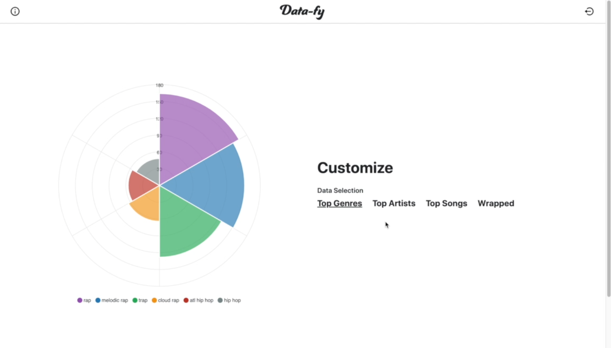
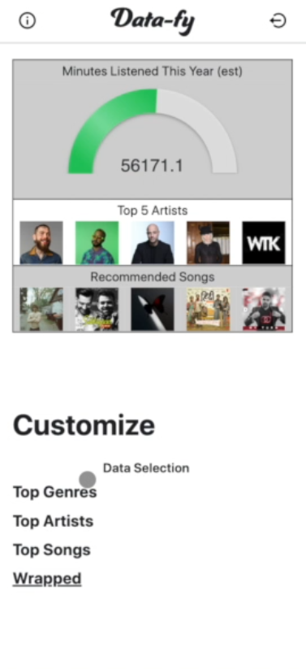
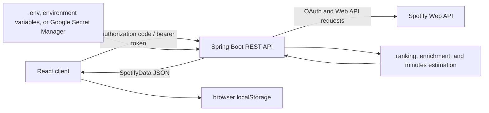

# Data-fy

Data-fy is a full-stack Java and React application that turns a Spotify account's listening data into ranked artists, tracks, genres, recommendations, and a summary view.

Data-fy was built in 2023 as a full-stack Spotify analytics project exploring the Web API, OAuth, concurrent API processing, and a stateless frontend/backend architecture. Its original public deployment has been retired; this repository preserves the source, architecture, tests, and deployment configuration as a technical record.



## What it does

After the user authorizes the application, Data-fy:

- exchanges Spotify's authorization code for an access token;
- retrieves the user's top artists and tracks across short-term (about four weeks), medium-term (about six months), and long-term (about one year) windows;
- derives a weighted top-six genre ranking from long-term top artists and artists found in recently played tracks;
- requests five recommendations seeded by the user's short-term top tracks and enriches them to full track records;
- produces a rough annual listening-minutes estimate from paginated long-term top-track durations; and
- presents the results as tables and charts, with time-range controls in the React dashboard.

The listening-minutes value is intentionally labeled as an estimate. It is not Spotify play-count history: the implementation treats the durations of up to 350 long-term top tracks as a representative week and extrapolates that value across 52 weeks.

## Interface

These historical captures show the original deployed interface on desktop and at an iPhone 12-sized viewport. The mobile dashboard adapts the listening-minutes estimate, top artists, recommendations, and data-selection navigation to the narrower layout.

<p align="center">
  
</p>

## Architecture



The backend is stateless with respect to users: it does not use a database or retain an HTTP session. The client sends its Spotify access token with the data request and stores the resulting aggregate in browser `localStorage` until logout. On the backend, Caffeine caches Google Secret Manager reads; it does not cache user listening data.

The longest-running calculation is submitted to a two-thread executor while the request thread fetches artists, genres, tracks, and recommendations. The response waits for that calculation before returning one consolidated `SpotifyData` object.

### API boundary

| Method | Route | Purpose |
| --- | --- | --- |
| `GET` | `/api/login` | Build the Spotify authorization URL. |
| `POST` | `/api/token` | Exchange an authorization code for an access token. |
| `GET` | `/api/data` | Build the aggregate response from a bearer token. |

## Engineering highlights

- Spotify authorization-code OAuth and scoped Web API access
- Offset-based pagination with an explicit 350-track boundary
- Parallel request processing with managed executor shutdown
- Weighted domain transformation for genre ranking
- Recommendation seeding followed by full-track enrichment
- One response model spanning multiple Spotify endpoint types
- Profile-based secret providers for local, container, and historical cloud environments
- Dedicated handling for Spotify OAuth failures such as `access_denied`, with a user-facing error route and recovery navigation
- Centralized error routing and configurable CORS/callback origins
- Deterministic backend and frontend tests that do not require Spotify credentials

## Technology

- Java 17, Spring Boot 3, Maven Wrapper
- Spotify Web API Java 7.3
- Caffeine cache
- Google Cloud Secret Manager and App Engine configuration
- React 18, React Router, Axios, Bootstrap, and ApexCharts
- Docker for backend and frontend packaging
- Netlify single-page-application redirect configuration

## Repository layout

```text
src/main/java/       Spring Boot application, configuration, controllers, and model
src/main/resources/  Spring configuration metadata
src/main/ui/         React client
src/test/java/       Backend unit and context tests
app.yaml             Historical Google App Engine configuration
Dockerfile           Backend container build
```

## Running locally

### Prerequisites

- Java 17
- Node.js 18 or newer and npm
- a Spotify developer application

Register `http://localhost:3000/auth-callback` as a redirect URI in the Spotify developer dashboard.

### Backend

Copy `.env.example` to `.env`, then set `CLIENT_ID` and `CLIENT_SECRET` to the credentials for your Spotify application. The example already contains the local callback and frontend origins.

```bash
./mvnw spring-boot:run
```

On Windows, use `mvnw.cmd spring-boot:run`. The API starts at `http://localhost:8080`.

### Frontend

In `src/main/ui`, copy `.env.example` to `.env`, then install and start the locked dependency set:

```bash
npm ci
npm start
```

The client starts at `http://localhost:3000` and uses `REACT_APP_URL` to locate the API.

### Docker

The backend image runs the test suite during its multi-stage build and selects the environment-variable secret provider at runtime:

```bash
docker build -t data-fy-api .
docker run --rm --env-file .env -p 8080:8080 data-fy-api
```

The frontend directory also contains a development-container definition; pass `REACT_APP_URL` when running it so the browser can reach the API.

### Configuration

| Variable | Required | Purpose |
| --- | --- | --- |
| `CLIENT_ID` | Yes | Spotify application client ID. |
| `CLIENT_SECRET` | Yes | Spotify application client secret. Never commit it. |
| `SPOTIFY_REDIRECT_URI` | No | OAuth callback; defaults to the local React callback. |
| `CORS_ORIGIN` | No | Browser origin allowed by the API; defaults to `http://localhost:3000`. |
| `FRONTEND_ORIGIN` | No | Target for error redirects; defaults to `CORS_ORIGIN`. |
| `REACT_APP_URL` | Frontend | Backend base URL; the frontend example uses `http://localhost:8080`. |

Spring profiles select the secret provider: `development` reads `.env`, `docker` reads environment variables, and the historical `production` profile reads `CLIENT_SECRET` from Google Cloud Secret Manager.

## Testing and builds

Backend tests cover application startup, authorization-code validation, bearer-token parsing, pagination boundaries, empty pages, invalid duration data, and external-fetch failures.

```bash
./mvnw verify
```

Frontend tests cover validation of complete and incomplete aggregate responses:

```bash
cd src/main/ui
npm ci
npm test -- --watchAll=false
npm run build
```

The GitHub Actions workflow runs both suites and both builds without live Spotify credentials.

## Deployment history and project status

The original application used a Netlify-hosted React frontend with a Spring Boot backend deployed through Google App Engine Standard. The repository retains the App Engine configuration, Google Cloud Secret Manager integration, Docker packaging, and Netlify SPA routing used by that deployment architecture.

The original hosted deployment is retired, and no live URL is presented here. End-to-end OAuth behavior has not been re-certified against a live Spotify application during this repository-maintenance pass. Before any future redeployment, the OAuth flow and the historical frontend build toolchain should receive a dedicated security and dependency review.

## Historical evolution

The commit history shows the application progressing from an early local implementation into separate React and Spring components, Docker packaging, production-oriented API routes and caching, Google App Engine/Secret Manager support, and finally a stateless backend in the 1.5-era work. Those iterations remain in Git history rather than being rewritten as a new application.

## Author

[Josh Valentino](https://joshvalentino.com)

## License

No open-source license has been added. The source is available for review, but no permission to copy, modify, or redistribute it is granted by this repository.
